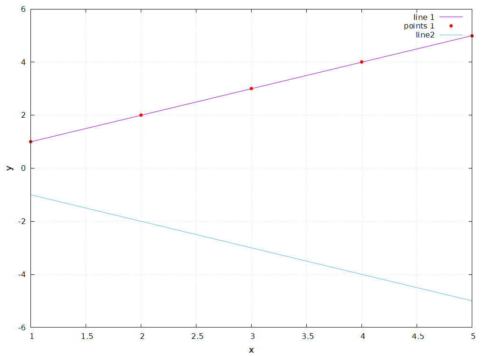

# A Lightweight Gnuplot Wrapper in Zig - inspired by Matplotlib API
*Why??*

*I just love exploring languages and their ecosystem, particularly in numerical analysis and simulations, yeah its a wierd enough reason. But exploring zig I couldn't find a gnuplot wapper with api I like, so as a dev does, I made one... The api is similar to matplotlib from Python. Although technically this packages is just a wrapper to convert the passed arrays and options into the command strings, but it does its job. Doesn't have much here as it is pretty simple to use. The below example demonstrate the features*

> [!WARNING]
> Only 2D line, bar and scatter plots are currently implemented, and the API may change as Zig 0.18 evolves.
> Image Showing Is Supported
> Vectors as argument are supported (only f64 typed)
> Couldn't figure out how to pass the vectors as references to the functions


# Installation
Fetch the repo
```bash
zig fetch --save git+https://github.com/halfdisposal/gnuplot-zig.git#HEAD
```
Include it in the `build.zig`
```zig
const gnuplot_dep = b.dependency("gnuplot_zig", .{
    .target = target,
    .optimize = optimize,
});
exe.root_module.addImport("gnuplot", gnuplot_dep.module("gnuplot_zig"));
```

# Usage
## Example
```zig
const std = @import("std");
const gnuplot = @import("gnuplot");
const Io = std.Io;

const Figure = gnuplot.Figure;

pub fn main(init: std.process.Init) !void {
    const io = init.io;
    const gpa = init.gpa;

    var fig = Figure.init(io, gpa, .{.term = "windows", .width = 1024, .height = 750});
    defer fig.deinit();

    const x = [_]i32{1, 2, 3, 4, 5};
    const y = [_]i32{1, 2, 3, 4, 5};
    const y2 = [_]i32{-1, -2, -3, -4, -5};
    try fig.xlabel("x", .{});
    try fig.ylabel("y", .{});
    try fig.grid();
    try fig.plot(&x, &y, .{.label = "line 1"});
    try fig.scatter(&x, &y, .{.label = "points 1", .color = "red"});
    try fig.bar(&y2, .{.label = "bar"});
    try fig.show();
}
```
## Vector Simd Input
```zig
const std = @import("std");
const gnuplot = @import("gnuplot");
const Io = std.Io;

const Figure = gnuplot.Figure;

pub fn main(init: std.process.Init) !void {
    const io = init.io;
    const gpa = init.gpa;

    var fig = Figure.init(io, gpa, .{.term = "windows", .width = 1024, .height = 750});
    defer fig.deinit();
    
    // Vectors are supported only for f64
    const x: @Vector(100, f64) = gnuplot.vspace(0.0, 6.28, 100);
    const y: @Vector(100, f64) = @sin(x)
    try fig.xlabel("x", .{});
    try fig.ylabel("y", .{});
    try fig.grid();
    try fig.plot(x, y, .{.label = "line 1"});
    try fig.show();
}
```

## Image Showing
```zig
const image = [_]f64{...};
try fig.imshow(&image, .{});
try fig.imshow("image.png", .{});
```



Each plot command is accompanied by a struct with options for the plot. Currently only 2D line and scatter plot are supported.
**Saving To File**
```zig
try fig.savefig("file.png");
```
Supported Files `png, jpg, jpeg, svg, pdf, gif, eps`

# Features
- **Lazy Evaluation**: No Commands (gnuplot side) is evaluated unless `fig.show()` or `fig.savefig(...)` is called.

I will try to keep the api as similar as possible to *matplotlib*, atleast where ever possible. 
